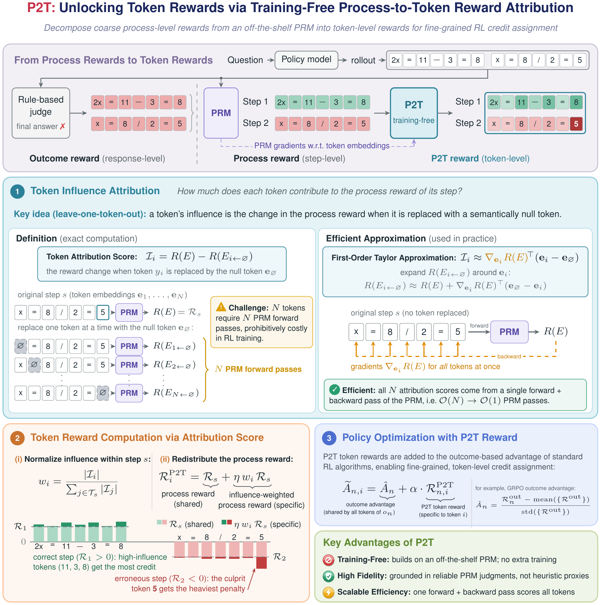

<div align="center">

# P2T: Unlocking Token Rewards via Training-Free Reward Attribution

**CVPR 2026**

Sitong Wu<sup>1</sup>, Haoru Tan<sup>3&dagger;</sup>, Bin Xia<sup>1</sup>, Xichen Zhang<sup>2</sup>, Jingyao Li<sup>1</sup>, Shaofeng Zhang, Xiaojuan Qi<sup>3</sup>, Bei Yu<sup>1</sup>, Jiaya Jia<sup>1,2&dagger;</sup>

<sup>1</sup>Chinese University of Hong Kong &nbsp;&nbsp; <sup>2</sup>Hong Kong University of Science and Technology &nbsp;, <sup>3</sup>University of Hong Kong


[](https://openaccess.thecvf.com/content/CVPR2026/html/Wu_Unlocking_Token_Rewards_via_Training-Free_Reward_Attribution_CVPR_2026_paper.html)
[](https://github.com/stonewst/P2T)
[](https://github.com/volcengine/verl)

</div>

<br>

<p align="center">
  
</p>

P2T converts the step-level rewards of an off-the-shelf process reward model (PRM) into token-level rewards for reinforcement learning. It is **training-free**, requiring no additional reward-model training, and attributes each step reward to every token in the step with **a single forward and backward pass of the PRM**.

## How it works

1. **Score each step.** An off-the-shelf PRM assigns a process reward to each reasoning step.
2. **Attribute the step reward to its tokens.** P2T estimates how much the step reward would change if a token were replaced by a semantically null token, using a first-order gradient approximation that scores all tokens at once.
3. **Optimize with token-level rewards.** The attributions are turned into token-level rewards, and the resulting token advantage is combined with the outcome advantage for policy optimization.

Formally, the attribution of token $i$ in a step is

$$
\mathcal{I}_i
= R(E) - R(E_{i \leftarrow \varnothing})
\approx \nabla_{\mathbf e_i} R(E)^\top(\mathbf e_i-\mathbf e_\varnothing),
$$

where $E$ is the sequence of token embeddings fed to the PRM, $R(\cdot)$ is the PRM's reward for the step, and $E_{i \leftarrow \varnothing}$ replaces the $i$-th embedding $\mathbf e_i$ with the null-token embedding $\mathbf e_\varnothing$.

This repository implements P2T on top of [verl](https://github.com/volcengine/verl). How attributions are turned into token rewards is set by `p2t_reward_mode`; the example script uses `v4`, and all modes are documented in [`p2t/prm/p2t_reward.py`](p2t/prm/p2t_reward.py).

## Results

Adding P2T to GRPO raises the average accuracy over nine math benchmarks from 43.0% to 47.2% for Qwen2.5-Math-1.5B with MATH-12k training data.

| Method | AIME24 | AIME25 | AMC23 | MATH-500 | GSM8K | MinervaMath | OlympiadBench | GaoKao2023en | HMMT25 | Avg. |
| --- | ---: | ---: | ---: | ---: | ---: | ---: | ---: | ---: | ---: | ---: |
| GRPO | 16.7 | 13.3 | 60.0 | 74.0 | 84.3 | 36.4 | 36.2 | 62.6 | 3.3 | 43.0 |
| **GRPO + P2T** | **23.3** | **20.0** | **65.0** | **79.4** | **85.2** | **38.5** | **40.4** | **66.0** | **6.7** | **47.2** |


## Repository guide

| Path | Purpose |
| --- | --- |
| [`train_p2t.sh`](train_p2t.sh) | End-to-end training example with all run settings |
| [`p2t/prm/`](p2t/prm/) | PRM scoring, token attribution, and token-reward construction |
| [`p2t/trainer/`](p2t/trainer/) | P2T trainer, advantage computation, and configuration |
| [`data/`](data/) | Bundled training and evaluation data |


## Quick start

### Install

The example trains with the FSDP backend and generates rollouts with vLLM. Install the dependencies with the bundled script (Megatron is not required):

```bash
git clone https://github.com/stonewst/P2T.git
cd P2T

conda create -n p2t python=3.10 -y
conda activate p2t

USE_MEGATRON=0 bash scripts/install_vllm_sglang_mcore.sh
pip install --no-deps -e .
```

### Prepare data and models

The repository includes [`data/MATH-12K/train.parquet`](data/MATH-12K/train.parquet) for training and [`data/MATH-500/test.parquet`](data/MATH-500/test.parquet) for evaluation. To prepare your own RL data in Parquet format, see [`examples/data_preprocess/`](examples/data_preprocess/).

In `train_p2t.sh`, set `MODEL_PATH` (policy) and `prm_path` (PRM) to either a Hugging Face model ID, downloaded automatically on first run, or a local directory. When using a different PRM, also set its step separator `algorithm.p2t.prm.sep` and check the related options in [`p2t/trainer/config/p2t_ppo_trainer.yaml`](p2t/trainer/config/p2t_ppo_trainer.yaml).

### Train

```bash
conda activate p2t
ray start --head
bash train_p2t.sh
```

The example is configured for **one node with eight GPUs**. It uses Qwen2.5-Math-1.5B as the policy, ReasonFlux-PRM-7B as the PRM, and the bundled MATH-12K data. Before launching, review the model paths, GPU count, and batch sizes in [`train_p2t.sh`](train_p2t.sh). Extra arguments are passed through as Hydra overrides, e.g. `bash train_p2t.sh trainer.total_epochs=5`.

The example logs to Weights & Biases, so run `wandb login` first, or pass `trainer.logger='["console"]'` to disable it.


## Citation

If you find P2T useful in your research, please cite:

```bibtex
@InProceedings{Wu_2026_CVPR,
    author    = {Wu, Sitong and Tan, Haoru and Xia, Bin and Zhang, Xichen and Li, Jingyao and Zhang, Shaofeng and Qi, Xiaojuan and Yu, Bei and Jia, Jiaya},
    title     = {Unlocking Token Rewards via Training-Free Reward Attribution},
    booktitle = {Proceedings of the IEEE/CVF Conference on Computer Vision and Pattern Recognition (CVPR)},
    month     = {June},
    year      = {2026},
    pages     = {5082-5091}
}
```

## Acknowledgements

P2T is built on [verl](https://github.com/volcengine/verl); we thank its authors and contributors.

## License

This repository is released under the [Apache 2.0 license](LICENSE).

## Contact

For questions, open a [GitHub issue](https://github.com/stonewst/P2T/issues) or contact Sitong Wu (stone-wu@link.cuhk.edu.hk, stonewst@163.com).
